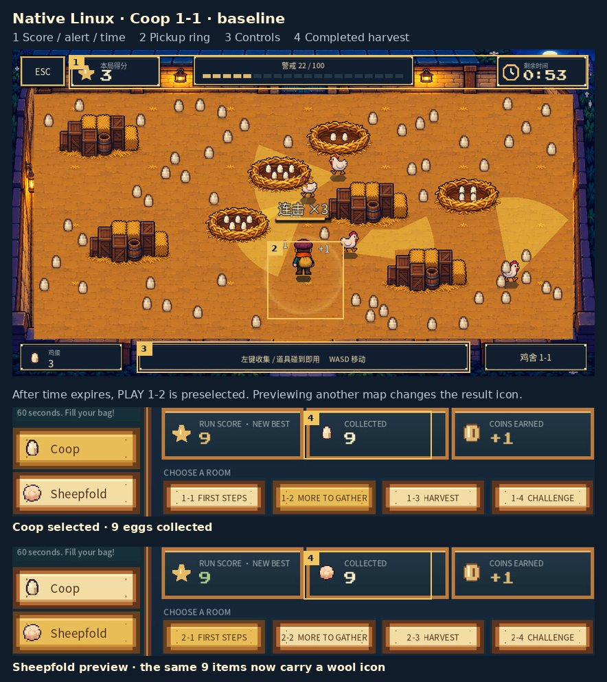
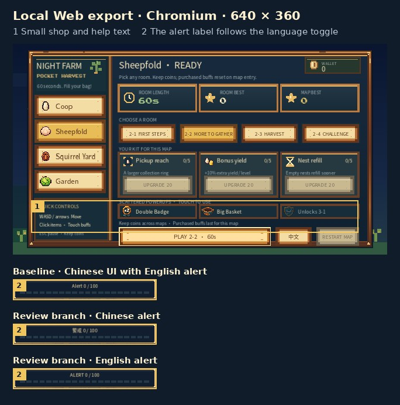
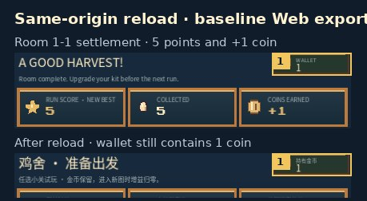

# 夜访鸡舍 · 首次试玩界面评审

基线为 `main` 的 [`4504eaf206b74b5de6c5ebdfef09cfc471af4989`](https://github.com/sd5913/Deepsleep-Dont-wake-up-chickens/commit/4504eaf206b74b5de6c5ebdfef09cfc471af4989)，使用 Godot 4.5.1 Standard 从 `project.godot` 进入 `res://scenes/arcade/game.tscn`。按 [界面设计](../UI_DESIGN.md) 和 [项目指南](../PROJECT_GUIDE.md) 核对了准备、局内与结算。下文的“实测”指评审者操作，“源码”指待复现的行为。新玩家能否看懂仍需无旁白试玩。

## 实际试玩

| 环境 | 操作与结果 |
| --- | --- |
| Linux 导出，实际窗口 1180×812，游戏画面约 1180×664 | 从干净存档打开中文菜单，切换英文并预览羊圈，回到鸡舍 1-1。按 `W` 移动并左键点击一颗圈内地面蛋，分数和收集数同时从 0 升到 3。按 `Esc` 暂停，中文与英文暂停卡均显示 3 分、53 秒。再按 `Esc` 后从 52 秒继续，英文收集数升到 9，最后五秒时钟变橙。到时结算 9 分、9 个物品及 1 金币，按钮预选 `PLAY 1-2`，一次点击后进入鸡舍 1-2。 |
| 本地 Web 导出，Chromium 156 软件渲染，640×360，`en-US` | 用独立浏览器配置测试基线和本分支。两种语言的主要按钮和 HUD 都在画面内，底栏操作提示和准备页增益说明明显缩小。实测中英切换、暂停／继续与羊圈 2-2 的地图／小关选择。桌面 Chromium 默认配置曾报缺少 WebGL2，软件渲染的测试进程成功启动。 |
| 基线 Web 导出，同一测试来源重载 | 在 Chromium 的全新配置中打开 `http://127.0.0.1:8765`，完成鸡舍 1-1，得到 5 分和 1 金币。原地址刷新后，钱包仍显示 1；同一来源的存档仍为 1-1 最高分 5、当前小关 2、可解锁地图计数 1。正式试玩或切换托管域名要分别验证。 |

准备页默认聚焦宽大的出发按钮，地图和小关用金色选中态。深色底板把分数、警戒、倒计时和资源计数从暖色场景中区分开。成功拾取时的飞蛋、跳分和计数变化互相印证，暂停卡同时保留分数与秒数，结算也把积分、收获和金币分开。

**本分支的小修复。** 英文系统下使用游戏内中文时，非零时显示 `警戒 22 / 100` 之类的中文，零值却显示英文 `Alert 0 / 100`，开局即可复现。Godot 对零值字符串套用了旧翻译表。警戒标签现直接使用游戏语言选择生成的文字。用英文系统语言复测中文 `警戒 0 / 100` 和英文 `ALERT 0 / 100`，并用临时 Godot 检查验证中英文在 0 与 21 两个值下的实际翻译结果。旧基线的同一检查复现了失败。

## 学生下一轮优先事项

| 优先级 | 复现与观察 | 验收条件 |
| --- | --- | --- |
| **P1 · 提示第一次拾取** | **实测。** 打开鸡舍 1-1。底栏写“左键收集”或 `Click to collect`，开局提示建议先移动。浅色拾取圈与巡逻扇形同时出现在场上。一次有效点击可收多枚蛋，规则需要从操作结果推断。英文 `Touch powerups` 也可能被理解成点按。 | 无旁白下，首次玩家能在第一局主动走近并左键收起地面物品，指出脚下圈的用途，并说出地面物品、资源窝和走过去触发的散落道具使用哪种操作。保留圈内、遮挡及资源窝逐个拾取规则。 |
| **P1 · 固定结算归属并说明下一步** | **实测。** 鸡舍 1-1 到时结束，在结算界面点“羊圈”。收集数仍为鸡舍的 9，图标却由鸡蛋变成羊毛。直接继续的按钮只写 `PLAY 1-2`；结算标题和分数卡未显示刚结束的关号。 | 结算显式显示刚结束的地图与小关，预览任意地图／小关时本局资源图标和收入保持对应。正常结束与被抓分别说明结束原因；自动选中下一关时主按钮明确写“下一关 1-2”／`Next room 1-2`，玩家主动改选后按钮说明所选目标。 |
| **P2 · 让风险指令能快速扫读** | **源码。** 进入动物视野直到警戒 ≥60；计时条用 `SPACE ON GOLD` 提示，且该分支优先于农夫追赶提示。继续到 100、等农夫入场，再比较局部警报与顶部文字。实测已看到警戒数值和最后五秒的橙色时钟，未专门复现该重叠状态。 | 能在中英文和 640×360 下分别认出“被发现”“按空格的时机”“农夫追赶时绕掩体”。农夫在场与计时条同时出现时，屏上仍有明确的避险动作；数值、触发阈值和空格判定沿用现有规则。 |
| **P2 · 说清金币与两类增益** | **实测。** 用 1 金币结束鸡舍 1-1，准备页提示 `Upgrade your kit`，最低价格为 20，购买键灰显。`Bonus yield` 的英文详情写 `+10% extra yield / level`，中文解释了“双份概率”；常驻增益和临时道具需要从两个区块辨认。 | 无悬停时就能说出还差 19 金币、哪三项可购买、金币跨图保留、此图增益何时重置，以及地上道具碰触即用；英文也明确说明每级提高获得双份的概率。 |
| **P2 · 顺畅的键盘焦点与小窗文字** | **实测。** 英文准备页预览羊圈后，从聚焦的 `PLAY` 连按三次 `Shift+Tab`，焦点框落在第一张灰显的升级卡按钮，`Enter` 未执行购买。640×360 下主要按钮可读，次要提示需要仔细看。**源码。** 小关／地图选择会重建菜单并把焦点设回出发按钮。 | 两种语言下，用 `Tab`、`Shift+Tab` 和 `Enter` 可完成选择地图、小关、出发、暂停、继续与结算后继续。焦点清晰、跳过不可操作的购买键，选择后位于合理位置。640×360 及菜园 4-4 实测中，动作提示与状态文字无需放大即可读，且不会遮住关键目标。 |
| **P3 · 对齐短消息的语言** | **实测。** Web 版在开局保护提示出现时立刻暂停、切换英文再继续，英文 HUD 上短暂保留刚才的中文提示。 | 两个方向都复测。语言切换后立刻重译或清除已在显示的短提示。 |

## 验证边界

- Godot 4.5.1 无头导入及 Web、Linux、Windows 导出已运行。八个街机回归脚本覆盖收集、巡逻、地图进度和道具，见 [项目指南](../PROJECT_GUIDE.md) 和 [`tests`](../tests)。
- 本次使用自由试玩模式，地图／小关可直接选择。正常顺序解锁由 `map_progression.gd` 的独立模式覆盖，仍可安排浏览器专项验收。
- 正式托管站点、Windows 互操作、触屏、读屏与真实新玩家理解未进行试玩验证。项目开局路线和生成物随种子变化，截图中具体蛋的位置仅供定位。
